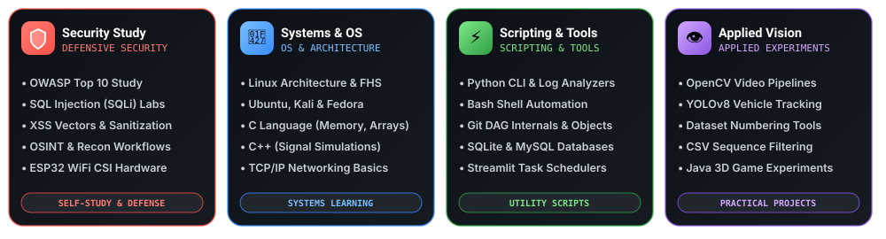

  

  

  

## 🛡️ Systems Engineering & Security Research Lab

  

> **"I believe the best way to build or protect software is to understand how computers work from first principles — from memory layout, network packets, and system calls up to web application vulnerabilities and defensive mitigations."**

  

## 🛠️ Technical Arsenal & Core Stack

  

<table width="100%">
  <tr>
    <td width="26%" valign="top"><strong>🛡️ Security &amp; Systems</strong></td>
    <td width="74%">
      
      
      
      
      
      
    </td>
  </tr>
  <tr>
    <td width="26%" valign="top"><strong>💻 Core Languages</strong></td>
    <td width="74%">
      
      
      
      
      
      
    </td>
  </tr>
  <tr>
    <td width="26%" valign="top"><strong>⚙️ Tools &amp; Infrastructure</strong></td>
    <td width="74%">
      
      
      
      
      
    </td>
  </tr>
  <tr>
    <td width="26%" valign="top"><strong>🔬 Applied / Explorations</strong></td>
    <td width="74%">
      
      
      
      
      
    </td>
  </tr>
</table>

  

## 📊 Live GitHub Activity

  <em>These stats update automatically with real-time profile activity and code contributions.</em>

  
  &nbsp;
  

  

  

  

## 🤝 Connect With Me

  <strong>Always open to discussing systems engineering, security research, Linux architecture, and collaborating on interesting technical projects!</strong>

 

&nbsp;

&nbsp;

&nbsp;

  

