 

&nbsp;&nbsp;

&nbsp;&nbsp;

&nbsp;&nbsp;

&nbsp;&nbsp;

&nbsp;&nbsp;

&nbsp;&nbsp;

  

<!--

  

-->
## 👤 About & Engineering Focus

  

  

## 🛠️ Technical Skills

<table width="100%">
  <tr>
    <td width="26%" valign="middle">
      <strong>🛡️ Cybersecurity &amp; Systems</strong> 
      Offensive &amp; Defensive Labs
    </td>
    <td width="74%">
      
      
      
      
      
      
        
      
      
      
      
      
    </td>
  </tr>
  <tr>
    <td width="26%" valign="middle">
      <strong>💻 Programming Languages</strong> 
      Systems &amp; Scripting
    </td>
    <td width="74%">
      
      
      
      
      
      
    </td>
  </tr>
  <tr>
    <td width="26%" valign="middle">
      <strong>🤖 AI, ML &amp; Agentic AI</strong> 
      Vision &amp; Autonomous Workflows
    </td>
    <td width="74%">
      
      
      
      
      
      
      
    </td>
  </tr>
  <tr>
    <td width="26%" valign="middle">
      <strong>⚙️ Tools &amp; Environment</strong> 
      Simulation, CAD &amp; Engineering
    </td>
    <td width="74%">
      
      
      
      
      
        
      
      
      
      
      
      
      
    </td>
  </tr>
</table>

  

## 📊 Live GitHub Activity

  <em>Live activity and metrics automatically updated from GitHub contributions.</em>

  
  &nbsp;
  

  

  

  

## 🤝 Connect

  <strong>Feel free to connect or collaborate on systems, Linux, and development projects!</strong>

 

&nbsp;&nbsp;

&nbsp;&nbsp;

&nbsp;&nbsp;

&nbsp;&nbsp;

&nbsp;&nbsp;

&nbsp;&nbsp;

&nbsp;&nbsp;

  

